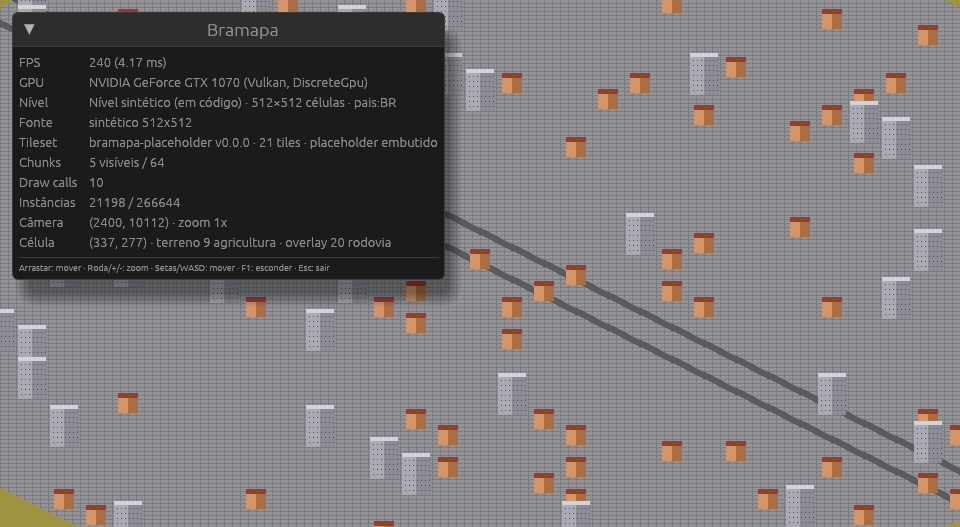

# Bramapa

Atlas interativo do Brasil (e vizinhos) com estética de jogo: isométrico 2.5D, pixel art animada,
estilo Roller Coaster Tycoon. Três níveis de zoom (país → estado → município), cada entidade com
propriedades e linha temporal. Não é um jogo: não há simulação nem gameplay. É um **framework**:
motor nativo + modelo de dados extensível por addons declarativos da comunidade.

**Performance é o critério 1. Rodar no máximo de dispositivos é o 2.**



## Os quatro repositórios

| Repo | O que é |
|---|---|
| **bramapa** (este) | Motor e app nativo em Rust + wgpu + winit + egui. A **spec dos contratos** mora em [`docs/spec/`](docs/spec/README.md). |
| [bramapa-pipeline](https://github.com/sandhas/bramapa-pipeline) | Geodado (IBGE, MapBiomas, SRTM, OSM) → chunks de tiles. Python, hot paths em Rust depois. |
| [bramapa-data](https://github.com/sandhas/bramapa-data) | Addons: dados com série temporal por entidade, sem código. Contribuição via PR. |
| [bramapa-tileset](https://github.com/sandhas/bramapa-tileset) | Arte: atlas de tiles + `tiles.toml`. |

Todos declaram `spec_version = 0`. A v0 é instável até o MVP existir.

## Decisões de arquitetura

- **Cliente nativo**, não navegador. Alvos: Linux, Windows, Android no MVP; macOS e iOS depois.
- **Mapa híbrido**: gerado offline a partir de geodados reais, com override manual por região.
  O cliente nunca processa geodado; só desenha chunks prontos.
- **Addons declarativos**: schema + séries temporais + regras de exibição. Zero código executável.
- **Dados em git**, build gera binários, sem backend.
- **3 níveis discretos**, cada um um tilemap próprio.
- **Render**: um draw call por chunk e por camada (terreno, overlay, objetos), instanciado;
  animação e profundidade calculadas no shader; nada atualizado por sprite na CPU.

## Crates

```
crates/bramapa-core     formatos (.bmc, level.toml, tiles.toml, manifest.toml), nível sintético
crates/bramapa-render   matemática isométrica, câmera, atlas, renderer de tilemap (wgpu)
crates/bramapa-app      janela, GPU, entrada, overlay egui; desktop (bin) e Android (cdylib)
```

## Rodar

```sh
cargo run --release                       # nível sintético 512x512, atlas placeholder embutido
cargo run --release -- --help
cargo run --release -- \
  --level ../bramapa-data-test/level-test \
  --tileset ../bramapa-tileset            # nível gerado pelo pipeline + tileset do repo de arte
cargo run --release -- --center 353,278 --zoom 2 --frames 120 --screenshot /tmp/bramapa.png
cargo test --workspace
```

Controles: arrastar com o mouse move, roda/`+`/`-` dão zoom (sempre inteiro), setas/WASD movem,
`F1` esconde o painel, `Esc` sai. Toque: arrastar move.

## Setup da máquina

- **Rust** 1.85+. Para o target Android é preciso `rustup` (o pacote `rust` do Arch não traz
  targets extras): `sudo pacman -S rustup && rustup default stable` e depois
  `rustup target add aarch64-linux-android`.
- **cargo-ndk**: `cargo install cargo-ndk`. Android SDK + NDK instalados (variável `ANDROID_HOME`).
- **GPU**: qualquer coisa com Vulkan, Metal, DX12 ou GLES 3.0. `WGPU_BACKEND=gl` força OpenGL.

### Android (Fase 1)

O crate `bramapa-app` já é `cdylib` com `android_main` (via `android-game-activity`). O que falta
na Fase 1: projeto Gradle mínimo com `GameActivity`, `cargo ndk -t arm64-v8a -o app/src/main/jniLibs build`,
e carregar nível/tileset dos assets do APK. O toque já está mapeado para mover a câmera.

## Orçamento de performance

| Métrica | Desktop | Android médio |
|---|---|---|
| FPS | 60 estável | ≥ 30 |
| Abertura até o nível 1 na tela | < 1,5 s | < 3 s |
| Transição de nível | < 300 ms | < 500 ms |
| RAM | < 500 MB | < 300 MB |

Medido na Fase 0 (GTX 1070, debug, 512×512 células = 266 mil instâncias): upload de 64 chunks em
12 ms, 240 fps (limite do compositor), 1 draw call por chunk-camada visível.

## Fases

0. **Fundação** (feita): spec v0, 4 repos, app desenha nível sintético e nível do pipeline.
1. **Render**: autotiling no pipeline, build Android no aparelho, primeira medição em celular.
2. **Nível 1**: Brasil + vizinhos a partir de Natural Earth, malhas IBGE e MapBiomas.
3. **Dados**: build binário do `ibge-core`, painel de entidade, seletor de intervalo temporal.
4. **Níveis 2 e 3**: RS e Porto Alegre, transições, override manual de exemplo.
5. **Comunidade**: addon externo de exemplo, guia de contribuição, benchmark, primeira release.

Fora de escopo: gameplay/simulação, addons com código, backend, navegador, zoom contínuo,
relações entre propriedades, mapa variando no tempo.

## Licença

MIT ou Apache-2.0, à sua escolha. Dados dos addons seguem a licença declarada em cada manifesto.
