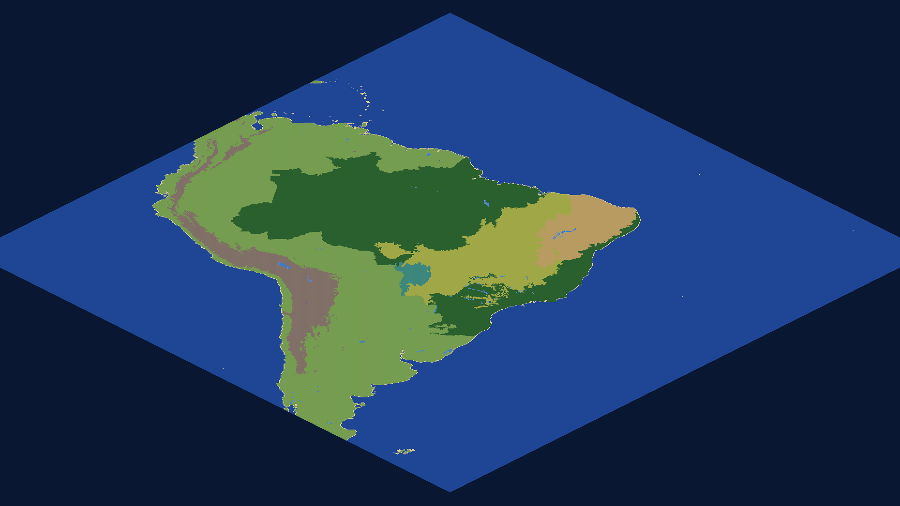
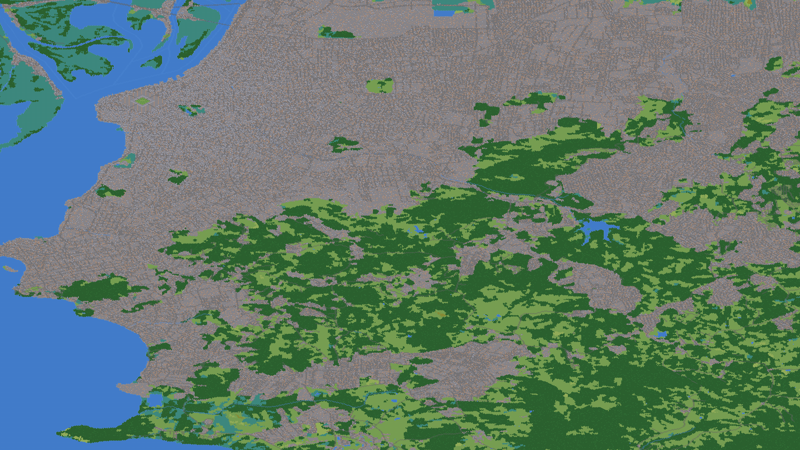
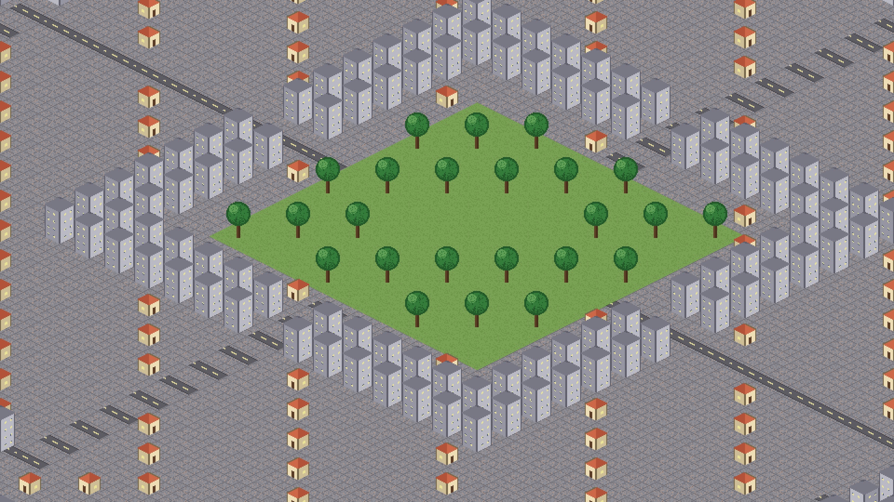
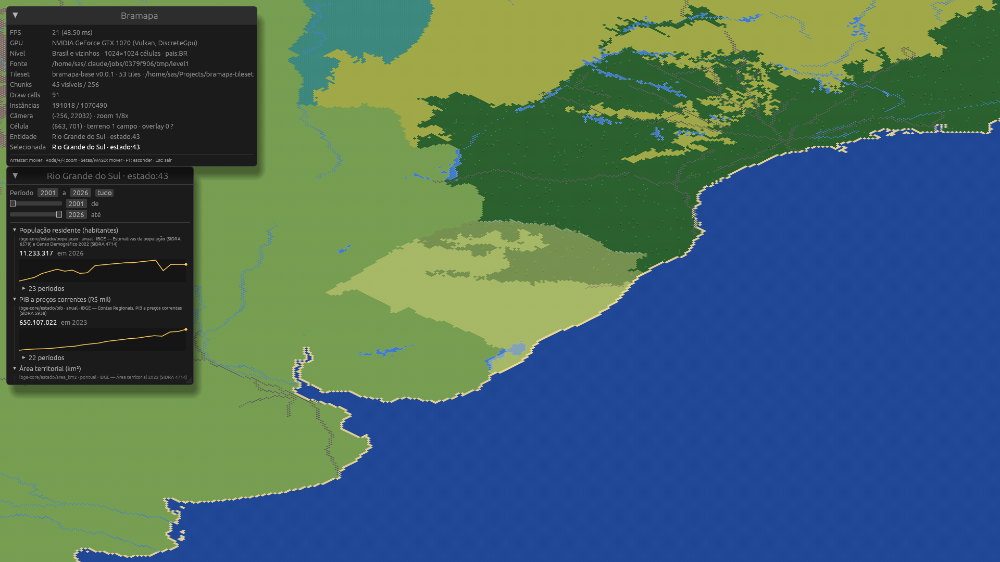

# Bramapa

Atlas interativo do Brasil (e vizinhos) com estética de jogo: isométrico 2.5D, pixel art animada,
estilo Roller Coaster Tycoon. Três níveis de zoom (país → estado → município), cada entidade com
propriedades e linha temporal. Não é um jogo: não há simulação nem gameplay. É um **framework**:
motor nativo + modelo de dados extensível por addons declarativos da comunidade.

**Performance é o critério 1. Rodar no máximo de dispositivos é o 2.**









## Os quatro repositórios

| Repo | O que é |
|---|---|
| **bramapa** (este) | Motor e app nativo em Rust + wgpu + winit + egui. A **spec dos contratos** mora em [`docs/spec/`](docs/spec/README.md). |
| [bramapa-pipeline](https://github.com/sandhas/bramapa-pipeline) | Geodado (IBGE, MapBiomas, SRTM, OSM) → chunks de tiles. Python, hot paths em Rust depois. |
| [bramapa-data](https://github.com/sandhas/bramapa-data) | Addons: dados com série temporal por entidade, sem código. Contribuição via PR. |
| [bramapa-tileset](https://github.com/sandhas/bramapa-tileset) | Arte: atlas de tiles + `tiles.toml`. |
| [bramapa-addon-energia](https://github.com/sandhas/bramapa-addon-energia) | Addon externo de exemplo (tarifas e capacidade instalada por UF, ANEEL): mostra que um addon vive em qualquer repositório. |

Todos declaram `spec_version = 0`. A v0 é instável até o MVP existir.

## Decisões de arquitetura

- **Cliente nativo**, não navegador. Alvos: Linux, Windows, Android no MVP; macOS e iOS depois.
- **Mapa híbrido**: gerado offline a partir de geodados reais, com override manual por região.
  O cliente nunca processa geodado; só desenha chunks prontos.
- **Addons declarativos**: schema + séries temporais + regras de exibição. Zero código executável.
- **Dados em git**, build gera binários, sem backend.
- **3 níveis discretos**, cada um um tilemap próprio.
- **Render**: um draw call por chunk e por camada (terreno, overlay, objetos), instanciado;
  animação e profundidade calculadas no shader; nada atualizado por sprite na CPU.

## Crates

```
crates/bramapa-core     formatos (.bmc, level.toml, tiles.toml, manifest.toml), nível sintético
crates/bramapa-render   matemática isométrica, câmera, atlas, renderer de tilemap (wgpu)
crates/bramapa-app      janela, GPU, entrada, overlay egui; desktop (bin) e Android (cdylib)
```

## Rodar

Sem compilar nada: a [release v0.1.0](https://github.com/sandhas/bramapa/releases/tag/v0.1.0)
traz o binário Linux, o APK Android (assinado com chave de desenvolvimento) e bundles com os três
níveis gerados, o tileset e o build de dados:

```sh
tar xzf bramapa-v0.1.0-linux-x86_64.tar.gz
tar xzf bramapa-v0.1.0-niveis-e-tileset.tar.gz
tar xzf bramapa-v0.1.0-dados.tar.gz
./bramapa --levels bramapa-levels --tileset bramapa-tileset --data bramapa-data-build --zoom 1/32
```

A partir do código:

```sh
cargo run --release                       # nível sintético 512x512, atlas placeholder embutido
cargo run --release -- --help
cargo run --release -- \
  --level ../bramapa-data-test/level-test \
  --tileset ../bramapa-tileset            # nível gerado pelo pipeline + tileset do repo de arte
cargo run --release -- --center 353,278 --zoom 2 --frames 120 --screenshot /tmp/bramapa.png
cargo run --release -- --no-ui --fullscreen --no-vsync   # benchmark

# nível 1 real (Brasil + vizinhos): gerar no pipeline e abrir
(cd ../bramapa-pipeline && uv run bramapa-pipeline fetch && \
  uv run bramapa-pipeline build-level1 --out ../bramapa-level1 --tileset ../bramapa-tileset)
cargo run --release -- --level ../bramapa-level1 --tileset ../bramapa-tileset --zoom 1/32

# os três níveis numa raiz (navegação país → estado → município)
(cd ../bramapa-pipeline && uv run bramapa-pipeline fetch && \
  uv run bramapa-pipeline build-level1 --root ../bramapa-levels --tileset ../bramapa-tileset && \
  uv run bramapa-pipeline build-level2 --uf 43 --root ../bramapa-levels --tileset ../bramapa-tileset && \
  uv run bramapa-pipeline build-level3 --municipio 4314902 --root ../bramapa-levels --tileset ../bramapa-tileset)
cargo run --release -- --levels ../bramapa-levels --tileset ../bramapa-tileset \
  --data ../bramapa-data-build --zoom 1/32

# dados do ibge-core no painel da entidade: build no repo de dados e abrir com --data
(cd ../bramapa-data && uv run bramapa-data build --out ../bramapa-data-build)
cargo run --release -- --level ../bramapa-level1 --tileset ../bramapa-tileset \
  --data ../bramapa-data-build --zoom 1/8
cargo test --workspace
```

Controles: arrastar com o mouse move, roda/`+`/`-` andam na escada de zoom (1/32 … 1/2 para
visão geral com mipmaps, 1 … 6 pixel-perfect), clique seleciona a entidade (estado/país) sob o
cursor, passar o mouse realça. Com `--data`, a entidade selecionada abre um painel com cada
propriedade (último valor, sparkline, tabela por período) e um seletor de intervalo de anos.
Com `--levels`, duplo clique, `Enter` ou o botão "Entrar" descem para o nível da entidade
(estado → município) quando ele foi gerado; `Backspace` ou "◀" voltam; o breadcrumb mostra o
caminho. Overrides manuais de mapa vêm do build de dados e são aplicados ao carregar o nível.
Setas/WASD movem, `F1` esconde o painel, `Esc` sai.
Toque: arrastar move, toque seleciona.

## Setup da máquina

- **Rust** 1.85+. Para o target Android é preciso `rustup` (o pacote `rust` do Arch não traz
  targets extras): `sudo pacman -S rustup && rustup default stable` e depois
  `rustup target add aarch64-linux-android`.
- **cargo-ndk**: `cargo install cargo-ndk`. Android SDK + NDK instalados (variável `ANDROID_HOME`).
- **GPU**: qualquer coisa com Vulkan, Metal, DX12 ou GLES 3.0. `WGPU_BACKEND=gl` força OpenGL.

### Android

Sem Gradle: o APK é montado pelo `cargo-apk` (`NativeActivity`). Metadados em
`crates/bramapa-app/Cargo.toml` (`[package.metadata.android]`).

```sh
# uma vez
curl -sSf https://sh.rustup.rs | sh -s -- -y --no-modify-path     # ou: sudo pacman -S rustup
~/.cargo/bin/rustup target add aarch64-linux-android x86_64-linux-android
~/.cargo/bin/cargo install cargo-apk
sdkmanager "ndk;27.2.12479018" "platforms;android-34"
keytool -genkeypair -keystore .android/dev.keystore -alias bramapa-dev -keyalg RSA \
  -keysize 2048 -validity 10000 -storepass android -keypass android -dname "CN=Bramapa dev"

# a cada build (celular real = aarch64; emulador x86_64 = x86_64-linux-android)
export ANDROID_HOME=~/Android/Sdk ANDROID_NDK_ROOT=~/Android/Sdk/ndk/27.2.12479018
PATH=~/.cargo/bin:$PATH cargo apk build -p bramapa-app --lib --release --target aarch64-linux-android
adb install -r target/release/apk/bramapa.apk
adb shell am start -n br.bramapa.app/android.app.NativeActivity
adb logcat -s bramapa:*          # imprime fps/draw calls a cada 300 quadros
```

O keystore `.android/dev.keystore` é só de desenvolvimento e fica fora do git. No Android o
app usa o nível sintético e o atlas embutido; nível/tileset dos assets do APK vêm na Fase 2.
Toque: arrastar move a câmera (pinça para zoom ainda não existe).

## Contribuir

Leia [`docs/contribuindo.md`](docs/contribuindo.md): addons de dados (no `bramapa-data` ou no seu
próprio repositório), overrides manuais de mapa, arte de tiles, pipeline e motor.

## Orçamento de performance

| Métrica | Desktop | Android médio |
|---|---|---|
| FPS | 60 estável | ≥ 30 |
| Abertura até o nível 1 na tela | < 1,5 s | < 3 s |
| Transição de nível | < 300 ms | < 500 ms |
| RAM | < 500 MB | < 300 MB |

Medido na Fase 0/1 (512×512 células = 266 mil instâncias, 1 draw call por chunk-camada visível):

| Onde | Upload de 64 chunks | Quadro | RAM |
|---|---|---|---|
| Desktop GTX 1070, debug, vsync off | 12 ms | 4,2 ms (240 fps, teto do compositor) | — |
| Emulador Android x86_64 (GPU do host), release | 39 ms | 1,5 ms (sem vsync) | 38 MB PSS |
| Desktop GTX 1070, nível 1 real (256 chunks, 1,07 M instâncias), zoom 1/32, debug | 60 ms | 4,2 ms (240 fps, 416 draw calls) | — |
| Desktop GTX 1070, nível 2 RS (256 chunks, 1,13 M instâncias), zoom 1/32, debug | 290 ms (leitura + upload) | 4,2 ms (240 fps, 654 draw calls) | — |
| Desktop GTX 1070, nível 3 Porto Alegre (529 chunks, 2,59 M instâncias), zoom 1/16, debug | 142 ms (upload) | 4,2 ms (240 fps, 465 draw calls) | — |

O emulador não mede celular: a primeira medição em aparelho real está pendente.

Benchmark reproduzível em [`docs/benchmark.md`](docs/benchmark.md) (`scripts/bench.sh`, ou
`bramapa --bench saida.md`): renderização fora da tela em 1080p com espera da GPU, por isso os
números não sofrem o teto do monitor. Resumo na GTX 1070 em release: Brasil inteiro (1,07 M
instâncias) 1,6 ms por quadro, Porto Alegre inteira (2,3 M) 3,2 ms, zoom 1x 0,3 ms.

## Fases

0. **Fundação** (feita): spec v0, 4 repos, app desenha nível sintético e nível do pipeline.
1. **Render** (feita, exceto medição em aparelho real): autotiling no pipeline guiado pelo
   `tiles.toml`, variantes de litoral no tileset, APK via `cargo-apk` rodando no emulador,
   vsync por padrão e flags de benchmark. Pendente: rodar `bramapa-arm64.apk` num celular médio
   e registrar fps/RAM na tabela acima.
2. **Nível 1** (feita): Brasil + vizinhos gerados de Natural Earth, malhas IBGE e biomas IBGE
   (MapBiomas fica para os níveis 2 e 3), 60 entidades (27 UFs + países), camada de entidade por
   célula, hover e clique em estado, escada de zoom com visão geral.
3. **Dados** (feita): formato `.bmd` nos dois lados, `ibge-core` com séries reais do SIDRA
   (população 2001–2026, PIB 2002–2023, área 2022, por UF e Brasil), painel da entidade com
   seletor de intervalo temporal.
4. **Níveis 2 e 3**: RS e Porto Alegre, transições, override manual de exemplo.
5. **Comunidade**: addon externo de exemplo, guia de contribuição, benchmark, primeira release.

Fora de escopo: gameplay/simulação, addons com código, backend, navegador, zoom contínuo,
relações entre propriedades, mapa variando no tempo.

## Licença

MIT ou Apache-2.0, à sua escolha. Dados dos addons seguem a licença declarada em cada manifesto.
